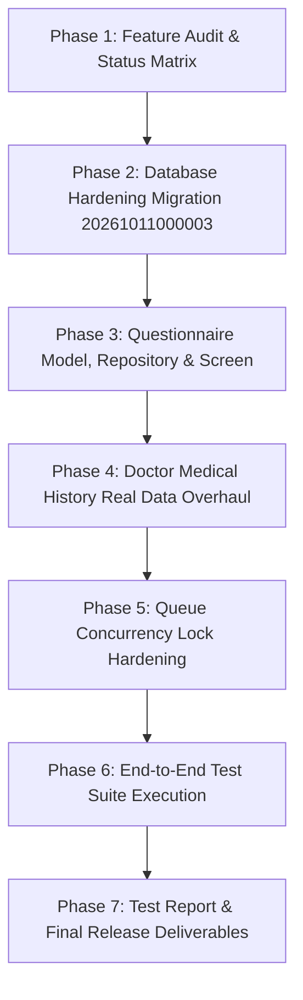

# CAREFLOW — IMPLEMENTATION & VERIFICATION PLAN

## 1. OBJECTIVES & PRIORITIES
1. **Security & Data Integrity (Priority 1)**: Prevent unauthorized record access, implement non-deletion rules on clinical history, and eliminate race conditions in the queue manager.
2. **Permanent Patient-Owned Medical History & Questionnaire (Priority 1)**: Implement the 20-section First-Login Medical History Questionnaire with save-progress, resume, and cross-clinic access.
3. **Cross-Clinic Doctor Medical History Review (Priority 1)**: Replace hardcoded mocks with real backend queries scoped by active patient access grants.
4. **Smart Medication Reminder & Caregiver Alert System (Priority 1)**: Finalize end-to-end integration and automated test coverage.
5. **End-to-End Acceptance Verification (Priority 1)**: Run automated tests across all roles and produce `docs/CAREFLOW_TEST_REPORT.md`.

---

## 2. SEQUENCE OF EXECUTION

---

## 3. COMPONENT MODIFICATION PLAN

### A. Database Migration: `20261011000003_careflow_medical_history_and_retention.sql`
- **Table**: `public.careflow_patient_medical_history`
  - Columns: `id`, `patient_id` (FK profiles), `questionnaire_data` (JSONB), `status` ('in_progress', 'completed'), `last_reviewed_at`, `created_at`, `updated_at`.
  - Constraint: `UNIQUE (patient_id)`.
- **Table**: `public.careflow_audit_logs`
  - Columns: `id`, `actor_id`, `action`, `resource_type`, `resource_id`, `metadata`, `created_at`.
- **Trigger**: Non-deletion rule on `careflow_consultations`, `careflow_reports`, `careflow_patient_medical_history`.
- **RPC**: Harden `careflow_call_next_patient` with `FOR UPDATE SKIP LOCKED` on `careflow_appointments`.

### B. Flutter Medical History Questionnaire
- **File**: `lib/screens/patient/medical_history/medical_questionnaire_screen.dart`
  - Covers all 20 required health categories.
  - Supports: In-progress save, resume from last section, edit, validation, conditional responses (e.g., condition details when 'Yes' is chosen).
  - Explicit badges marking answers as **Patient-Reported** (not verified clinical diagnosis).
- **Repository**: `lib/repositories/patient_medical_history_repository.dart`
  - `getHistory(patientId)`
  - `saveHistory({required Map<String, dynamic> data, bool isCompleted})`

### C. Doctor Medical History Overhaul
- **File**: `lib/screens/doctor/medical_history/medical_history_screen.dart`
  - Replaces hardcoded mock tuples with real Supabase queries.
  - Displays: Patient-reported conditions, allergies, current medicines, past surgeries, verified consultations, prescriptions, and lab reports.
  - Displays clear source attribution ("Patient-Reported" vs "Doctor-Verified").

### D. Automated Verification Suite
- **File**: `test/full_careflow_system_verification_test.dart`
  - Tests questionnaire saving and resumption.
  - Tests non-deletion trigger logic.
  - Tests queue concurrency serialization.
  - Tests cross-clinic access scoping.
